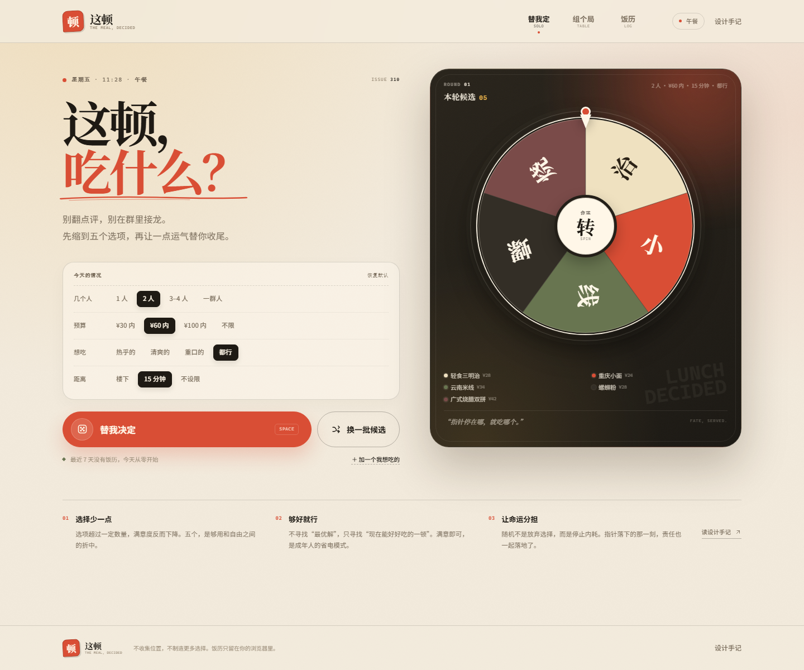
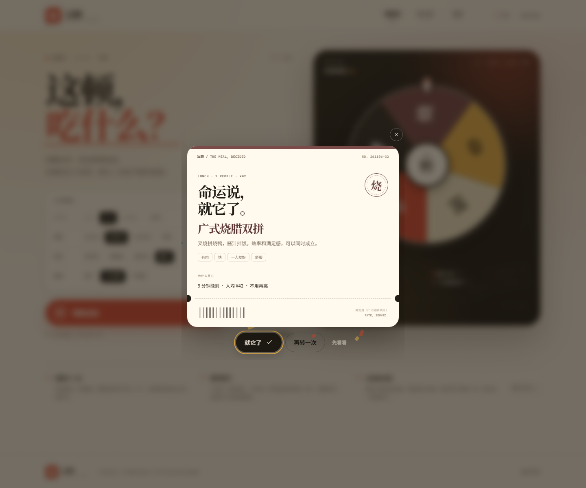
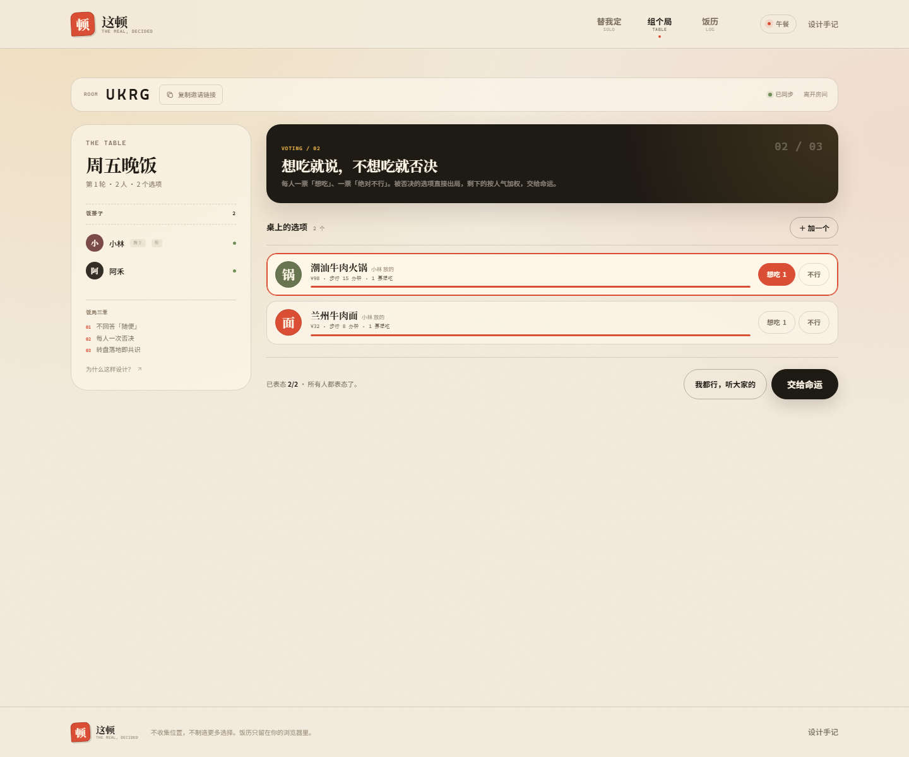

# 这顿 · THE MEAL, DECIDED

一个在饭点替你（和你的饭搭子）做决定的小工具。

> 别翻点评，别在群里接龙。先缩到五个选项，再让一点运气替你收尾。



## 为什么做这个

“吃什么”看起来是个信息问题，实际上常常是个决策问题：

- **选择过载**：选项越多，人越容易推迟决定，也越难对结果满意。
- **满意即可**：饭点不需要“最优解”，只需要一个“现在能好好吃”的解。Herbert Simon 把这叫 satisficing。
- **随机是一种承诺装置**：当结果由转盘产生，“选错”的责任被分摊给命运，人更容易停止反刍。
- **“随便”不是没有偏好**：它往往意味着“我不想承担决定的责任”。所以「这顿」不把“随便”当成一个选项，而是把它翻译成“听大家的”，或按最低决策成本替你选。

## 功能

### 一人食 / 替我定

- 按当前饭点自动生成候选：早餐、午餐、下午茶、晚餐、夜宵。
- 四个轻量条件：人数、预算、口味、距离。
- 决策引擎先做硬过滤，再按分数与菜系/色块多样性只留 **5 个**候选。
- 点击转盘或按空格，五个候选等概率交给命运。
- 结果是一张可保存、可转发的“饭票”，并带高德地图搜索入口，解决“去哪吃”。
- “再转一次”会排除当前结果，避免原地打转。
- 可以添加自己的私藏选项；写“随便”会被温柔地拒绝。

### 饭局 / 组个局

- 创建四人房间码，把邀请链接丢进群里即可加入。
- 每个人都可以往桌上加具体选项；内置快捷选项。
- 匿名投票 + **每人一次否决权**：被否决的选项直接出局，避免“转到了但没人吃”。
- 幸存选项按人气加权，但人气只影响概率，不直接钦定；最后由命运收尾。
- SSE 实时同步；房主离线 30 秒后自动移交主持权。
- 结果可以复制、保存饭票、地图找店，或由房主再来一轮。

### 饭历

- 记录已经决定好的每一顿：一人食或饭局。
- 统计总顿数、最常吃、省下的纠结时间。
- 数据只存在浏览器 `localStorage`，没有账号、没有上传。
- 默认避开最近 7 天吃过的选项。



## 快速开始

要求：Node.js 20 或更高版本。没有前端构建步骤，也没有第三方运行时依赖。

```bash
# 在项目根目录
npm start
```

打开：

```text
http://localhost:4173
```

开发模式（修改服务端代码后自动重启）：

```bash
npm run dev
```

跑单元测试：

```bash
npm test
```

需要 Node 原生 test runner 的完整发现能力时，可以运行：

```bash
npm run test:all
```

API 冒烟测试需要先启动服务：

```bash
npm start
# 另一个终端
node test/api-smoke.mjs
```

## 多人饭局怎么用

1. 用 `npm start` 启动服务，终端会打印本机和局域网地址。
2. 房主打开「组个局」，创建房间，复制房间码或邀请链接。
3. 同事/朋友在同一局域网内打开同一个地址（例如 `http://192.168.x.x:4173`），输入四位房间码加入。
4. 大家加选项、投票、否决；房主点「交给命运」。
5. 结果会实时同步到所有在线页面。

> 房间只存在内存里，服务重启即清空；房间 12 小时后自动过期。跨公网使用需要自行部署并配置 HTTPS/反向代理。

## 部署到 GitHub Pages

GitHub Pages 可以直接发布仓库根目录。源文件里的 `index.html` 在 `public/` 下，所以项目会把静态版生成到根目录，生成后根目录会多出：

```text
index.html
styles.css
manifest.webmanifest
js/
assets/
.nojekyll
```

1. 重新生成根目录静态站：

```bash
npm run build:pages
```

2. 提交根目录生成的文件和 `public/` 源文件。
3. 打开 GitHub 仓库 → **Settings → Pages**。
4. **Source** 选择 **Deploy from a branch**，Branch 选 `main`，目录选 **`/ (root)`**。
5. 访问 `https://<你的用户名>.github.io/<仓库名>/`。

静态版可以正常使用：

- 一人食、五选一转盘、结果饭票、地图找店
- 饭历、设计手记
- 移动端布局

静态版不能使用**联机饭局**：GitHub Pages 只托管文件，不能运行 `server.js`，也没有房间 API 和 SSE。点击「组个局」会看到一个说明页，而不是报错。

如果需要完整联机功能，可以把 `server.js` 部署到 Render、Railway、Fly.io 等支持 Node 的平台，再访问该平台提供的地址。不要手工修改根目录的 `index.html`、`js/` 等生成文件；改 `public/` 后重新运行 `npm run build:pages` 即可。`docs/` 目录只保留 README 的预览图。

## 设计笔记

### 视觉

- 纸张米色、炭黑、番茄红、芥末黄、橄榄绿，来自“饭桌、餐票、印章”的意象。
- 标题用 Noto Serif SC，正文用 Noto Sans SC；代码/标签用等宽字体。
- 餐票式结果卡、转盘、印章、虚线撕口，让“决定”有一个可触摸的结束动作。
- 移动端先看到转盘，再看到条件；默认值足够好，减少第一步的负担。

### 决策算法

```text
硬约束：饭点、人数、预算上限、距离上限
软评分：价格匹配、步行时间、排队、人数匹配、口味、是否最近吃过
多样性：优先不同菜系、不同色块
随机：五个候选等概率
```

饭局算法：

```text
1. 任一玩家否决的选项直接出局
2. 幸存选项权重 = 1 + 2 × 想吃票数
3. 加权随机抽取
4. 全员否决时，从所有选项中兜底抽取
```

### 心理学边界

这不是一个“替你生活”的工具。它只处理饭点那一个具体的、低风险的决策。真正的偏好仍然由你输入：预算、距离、忌口、否决权。随机只负责最后一步，而且结果可以保存、可以分享、可以重来——重来本身也在告诉你：你其实有偏好。

## 技术结构

```text
.
├── index.html                # GitHub Pages 根首页（build:pages 生成）
├── styles.css                # Pages 生成
├── manifest.webmanifest      # Pages 生成
├── js/ assets/ .nojekyll     # Pages 生成
├── server.js                 # 零依赖 HTTP 服务：静态文件 + 房间 API + SSE
├── package.json
├── README.md
├── public/
│   ├── index.html            # 单页应用源文件
│   ├── styles.css            # 设计系统与响应式布局
│   ├── manifest.webmanifest
│   ├── assets/icon.svg
│   └── js/
│       ├── app.js            # 路由、localStorage、饭历、全局对话框
│       ├── solo.js           # 一人食流程、结果饭票
│       ├── group.js          # 饭局、投票、SSE、静态版降级说明
│       ├── wheel.js          # SVG 转盘与旋转动画
│       ├── engine.js         # 纯函数决策引擎（浏览器/Node 共用）
│       ├── data.js           # 28 个饭局原型与设计 token
│       ├── share.js          # Canvas 饭票导出
│       └── ui.js             # DOM/存储/toast/彩纸等小工具
├── test/
│   ├── engine.test.mjs       # 11 个决策引擎单元测试
│   └── api-smoke.mjs         # 房间 API 冒烟测试
├── scripts/
│   └── build-pages.mjs       # 生成根目录 Pages 静态站
└── docs/                     # README 预览图
```

### API

| Method | Path | 说明 |
| --- | --- | --- |
| `POST` | `/api/rooms` | 创建房间 |
| `POST` | `/api/rooms/:code/join` | 加入房间 |
| `GET` | `/api/rooms/:code?playerId=` | 读取房间状态 |
| `GET` | `/api/rooms/:code/events?playerId=` | SSE 实时房间事件 |
| `POST` | `/api/rooms/:code/options` | 加选项 |
| `POST` | `/api/rooms/:code/start` | 房主开始表态 |
| `POST` | `/api/rooms/:code/vote` | 投票 / 否决 / 听大家的 |
| `POST` | `/api/rooms/:code/draw` | 房主交给命运 |
| `POST` | `/api/rooms/:code/again` | 房主再来一轮 |
| `POST` | `/api/rooms/:code/leave` | 离开房间 |
| `GET` | `/api/health` | 健康检查 |

房间状态只保存在内存中；没有数据库、没有账号、没有第三方追踪。API 会校验玩家身份（`playerId`）、选项长度、重复选项与房主权限。

## 测试与验收

- 11 个决策引擎单元测试：饭点、硬过滤、候选多样性、自定义选项优先级、加权抽样、饭局否决、全员否决兜底、饭历统计。
- API 冒烟测试：建房、加入、拒绝“随便”、重复选项、投票、否决、开转、再来一轮、404。
- 视觉验收：桌面 1440×1200、移动 390×844；使用无头 Edge + CDP 截图检查过首页、结果饭票、饭局大厅、投票、饭局结果和移动端。




## 已知边界

- 内置餐厅是“饭局原型”，不是实时餐厅数据库；真实门店请用「地图找店」。
- 没有接入定位、营业时间、排队、菜单或点评数据。
- 房间存在内存里，适合一次饭局，不适合长期群组。
- 没有账号体系；换设备/换浏览器会失去房间身份和本地饭历。
- 未实现跨公网部署的鉴权、限流和持久化。生产化前需要补上这些。

### 下一步可以做

- 接入地图/点评 POI，按真实距离与营业时间过滤。
- 房间持久化 + 链接邀请 + 微信/系统分享。
- 每人独立“忌口档案”，在候选生成阶段直接排除。
- 决策耗时统计与“本周饭历”分享卡片。
- 可选的“无随机”模式：只做加权排序，不转盘。
- PWA 离线缓存与安装引导。

## 作者

**Evan Shen** · 成都

## 参考

- Iyengar, S. S., & Lepper, M. R. (2000). *When Choice is Demotivating: Can One Desire Too Much of a Good Thing?*
- Schwartz, B. (2004). *The Paradox of Choice: Why More Is Less.*
- Simon, H. A. (1956). *Rational Choice and the Structure of the Environment.*
- 产品内“设计手记”对上述概念做了面向普通用户的转译。

---

**这顿，定了。**
